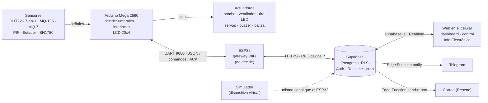

# Smart Greenhouse — Invernadero Inteligente

Invernadero IoT para el curso **Electrónica Digital (UMG)**. La electrónica es la base y la web la hace visible:
cada lectura en pantalla explica qué sensor la produjo, por qué pin entra y qué fórmula la convierte.



- **Arduino Mega:** lee los sensores, decide con umbrales e interlocks y mueve los actuadores. Funciona sin internet.
- **ESP32:** solo comunica. Reenvía la telemetría, trae los comandos y devuelve el ACK.
- **Supabase:** guarda los datos, autentica y genera alertas.
- **Web:** muestra los datos, envía *intenciones* y explica la electrónica. Nunca muestra un estado que el Mega
  no confirmó.

## Estructura

| Carpeta | Contenido |
| --- | --- |
| `apps/web` | SPA en React 19 + Vite + Tailwind v4 |
| `packages/contracts` | Contrato JSON v1 (Zod), compartido por la web y el simulador |
| `tools/simulator` | Dispositivo virtual: emula al Mega y al ESP32 por el mismo canal real |
| `firmware/` | Arduino Mega (control) y ESP32 (gateway) |

## Correr

```bash
pnpm install
cp apps/web/.env.example apps/web/.env.local   # URL y anon key del proyecto Supabase
pnpm dev
pnpm lint && pnpm typecheck && pnpm build
```

El esquema de la base de datos se mantiene fuera de este repositorio.
